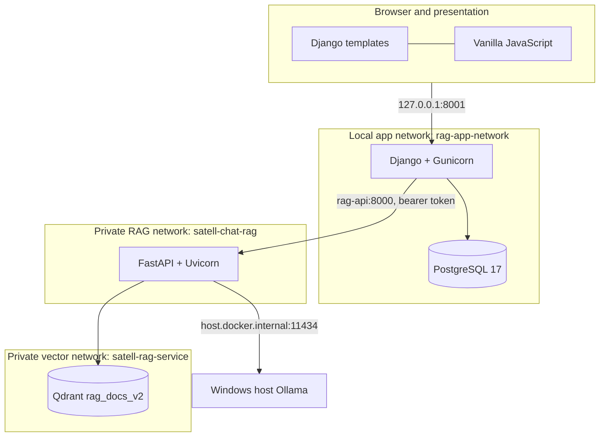

# Satell architecture

## Component view

Observed network names are `rag-app-network`, `satell-chat-rag`, and `satell-rag-service`. PostgreSQL is on the app network; the API is on chat and vector networks; Qdrant is on the vector network. Django reaches FastAPI by the Compose service name `rag-api`. Ollama remains on Windows. FastAPI has no published host port. The local UI, PostgreSQL, Qdrant and Ollama listeners inspected at audit time were bound to loopback on the host.

## Responsibility boundaries

| Component | Owns | Does not own |
|---|---|---|
| Browser | HTML form submission, loading UI, Markdown rendering, copy controls | Service token, tenant/principal scope, direct Qdrant/Ollama access |
| Django | User/session auth, CSRF, conversation ownership, durable message/citation/metadata persistence | Retrieval, embeddings, model execution, Qdrant access |
| FastAPI | Typed RAG query boundary, bearer auth, server-side authorization, rate limit, readiness | Browser sessions or conversation persistence |
| RAG service | Query embedding, dense/hybrid orchestration, context assembly, generation, verification | Legal review decisions |
| PostgreSQL | Users, conversations, messages, citation snapshots, generation metadata | Vector similarity search |
| Qdrant | Dense vectors and retrieval payloads | Django chat history |
| Ollama | Local embedding and generation runtime | Application authorization or durable chat records |

## Request execution model

- Django uses `config.wsgi:application` under Gunicorn, one synchronous worker.
- FastAPI is created by `create_app()` and started using `uvicorn.run()` in `scripts/run_api.py`; endpoint functions are synchronous `def` handlers. Uvicorn/Starlette runs sync handlers through its threadpool, but this is not an asynchronous token stream.
- The active browser path is traditional POST/redirect/GET. The browser waits for the entire RAG operation. No background queue, task broker, cancellation endpoint, or streaming protocol is present.
- The synthetic API service is a test service. It is currently present as a healthy container but is not the selected Django adapter target.

## Identity and authorization

Django authenticates the human. Django's server-side API token authenticates the Django service to FastAPI. The current local demo sets a single server-side tenant/principal. Human user IDs are not forwarded to Qdrant; RAG document access is shared across logged-in application users. Conversation history is isolated by Django query ownership. This is suitable only for the current shared technical-docs demo, not private per-user document ACLs.

Production index authorization and local demo authorization are distinct. Production requires a reviewed manifest plus evidence-backed source/document decisions. Local demo mode is opt-in and checks a dedicated policy and HMAC-signed registries, while keeping legal statuses `pending`.

## Evidence locations

- Django config/routes: `django_app/config/settings.py`, `django_app/config/urls.py`, `django_app/conversations/urls.py`.
- FastAPI and schemas: `src/rag_pipeline/api/app.py`.
- API construction/runtime: `scripts/run_api.py`, `django_app/compose.rag.yaml`.
- Django/API network: `django_app/compose.yaml`, `django_app/compose.rag.yaml`, `infrastructure/postgres.compose.yaml`.
- Diagram: [`diagrams/architecture.md`](diagrams/architecture.md), [`diagrams/deployment_network.md`](diagrams/deployment_network.md).
