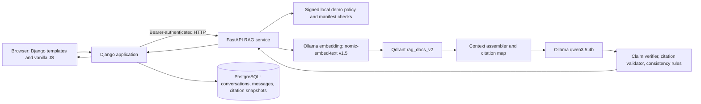

# Satell — complete project report

**Assessment date:** 2026-11-19  
**Project:** Satell — Secure RAG Chat Workspace  
**Assessment:** local academic demo operational; production readiness blocked.

> This is an engineering assessment, not a legal opinion or a guarantee of security or factual correctness. “Operator-authorized” for a local demo does not mean licensed, legally approved, or production-authorized.

## Chapter 1 — Project overview

Satell is a local, browser-based chat workspace that answers technical documentation questions by retrieving evidence from a controlled corpus, generating a response with a local model, checking claims and citations, and persisting the conversation in PostgreSQL. Its main contribution is the composition of user ownership, explicit evidence scopes, Qdrant filters, bounded context assembly, claim-level checks, citation mapping, abstention, and auditable metadata. A generic chatbot typically generates from model weights alone and cannot show this chain of evidence.

The intended users are supervised academic evaluators and engineers. Current functionality includes login, owned conversations, local documentation retrieval, citations, verification labels, saved history and an operator-only local academic demo policy. It is not a public or commercial service. Its most important limitations are pending legal review, a blocked production authorization path, variable answer quality, single-worker serving, incomplete fresh-machine deployment, and no high-availability/incident operations.

## Chapter 2 — Problem formulation

Keyword search can miss semantically phrased questions; vector search can miss exact identifiers and can retrieve plausible but irrelevant passages. A language model can then produce fluent unsupported text. Satell therefore separates retrieval, context assembly, generation, citation validation, and claim verification. The response is withheld or marked as partial when the evidence/format/verifier checks fail.

The design also recognizes that content permissions are separate from technical availability: source licenses and individual paper terms are not inferred from a public URL. Local inference avoids sending corpus text to a hosted LLM API, but trades away larger model capacity and managed availability. Documentation versions may conflict or become stale; the system can reject some freshness questions and uses limited version-consistency rules, but it cannot prove every claim correct.

## Chapter 3 — Requirements and status

| Requirement | Status | Evidence/limit |
|---|---|---|
| Login, session, CSRF | Implemented and exercised | Django auth, CSRF middleware and browser regression. Local cookie security flags are not production TLS settings. |
| Conversation create/read/delete | Implemented | Owner-scoped queries and foreign-key cascade. |
| User and assistant message persistence | Implemented | PostgreSQL; RAG call is synchronous. Pending messages can be stranded by process interruption. |
| Browser-to-RAG query | Implemented in local demo | Server-side HTTP adapter; production legal gate blocks. |
| Citations and saved citation metadata | Implemented | Snapshot fields include internal IDs; UI renders public title/section/pages/link. |
| Claim verification and citation format checks | Implemented, imperfect | Same local Qwen model is used for answer and verifier; model verification is not proof. |
| Safe abstention | Implemented | No authorized context, insufficient evidence, validation rejection, or incomplete comparison scope can withhold the answer. |
| Human/legal source and document authorization | Blocked | 14 source decisions pending; required production document registry absent. |
| User-specific document ACLs | Partial | Django conversation ownership is per user; current RAG scope is one server-side local tenant/principal and shared documentation set. |
| Streaming/cancellation | Not implemented | Non-streaming Ollama response; one synchronous Django worker. |
| Monitoring/SLO/high availability | Not implemented | Local health/readiness and bounded JSON diagnostics exist; no production metrics/alerting or HA. |
| Clean-machine deployment | Partial/blocked | Current host depends on existing data, models, networks and secrets. |

## Chapter 4 — System architecture

The active request architecture is:

The [repository map](SATELL_REPOSITORY_MAP.md) distinguishes active services from operator tools and historical artifacts. The expanded diagrams are [architecture](diagrams/architecture.md), [request sequence](diagrams/request_sequence.md), [deployment](diagrams/deployment_network.md), [security boundaries](diagrams/security_boundaries.md), [ingestion](diagrams/ingestion_pipeline.md), and [retrieval/verification](diagrams/retrieval_verification.md). Detailed boundary behavior is in [SATELL_ARCHITECTURE.md](SATELL_ARCHITECTURE.md) and [SATELL_DATA_FLOW_AND_REQUEST_LIFECYCLE.md](SATELL_DATA_FLOW_AND_REQUEST_LIFECYCLE.md).

## Chapter 5 — Technology stack

The verified inventory, exact pinned versions, active/inactive status, alternatives, and limitations are in [SATELL_TECH_STACK_AND_DEPENDENCIES.md](SATELL_TECH_STACK_AND_DEPENDENCIES.md). No original ADR was found for most choices; stated rationale is labelled current engineering rationale rather than historical fact.

Core runtime remains on the existing image digests: Python 3.13.17; Django 5.2.13; FastAPI 0.163.1/Pydantic 2.14.3/Uvicorn 0.54.0; PostgreSQL 17.12; Qdrant 1.20.1; Ollama 0.40.16; `qwen3.5:4b` Q4_K_M; `nomic-embed-text:v1.5` at 768 dimensions; Gunicorn 27.0.1 and WhiteNoise 6.12.0. Separate Phase 6 candidates use Django 5.2.17 and are not deployed. BM25/SQLite FTS5, RRF and the ONNX cross-encoder exist but are not active in the configured request path. Cohere is not present or used.

## Chapter 6 — Django backend

`django_app/config/settings.py` configures environment-based secrets, PostgreSQL/SQLite test selection, auth/password validators, CSRF and session middleware, WhiteNoise, and a 65,536-byte Django request body limit. Routes in `config/urls.py`, `accounts/urls.py` and `conversations/urls.py` serve HTML pages rather than a public JSON chat API. `conversations/views.py::_owned_conversation` filters by `request.user` in SQL; views require login and use GET/POST restrictions.

`chat/views.py::message_create` validates the 5,000-character form, atomically persists the user message and a pending assistant message, calls `rag_client.get_rag_client()` synchronously, then atomically persists the response, citations and generation metadata. `rag_client/client.py::FastAPIRAGClient` validates the response contract and maps failures to typed safe errors. The client is never imported into browser JavaScript. No conversation history is sent to FastAPI; follow-up turns are standalone questions despite being stored together.

## Chapter 7 — FastAPI backend

`scripts/run_api.py::main` loads exact model/config assets, constructs the embedding provider, Qdrant store, retrieval service, generator and API, then runs Uvicorn. `src/rag_pipeline/api/app.py::create_app` declares `QueryRequest` and `QueryResponse`, request-size/correlation middleware, bearer auth, fixed-window rate limiting, `/health`, `/ready` and `/v1/query`. OpenAPI/docs routes are disabled. Query/readiness requests require the bearer credential; `/health` is unauthenticated liveness only.

`/ready` validates either the production manifest or the separate local-demo registries and then checks embedding, Qdrant and Ollama. The live runtime uses `authorization_mode=local_academic_demo` with its explicit enable flag. Production `check_index()` still requires reviewed source and document authorization and rejects the current manifest.

## Chapter 8 — Database architecture

PostgreSQL stores Django users and the application conversation domain. `Conversation` has a UUID, user FK and timestamps; `Message` has a UUID, role/status check constraints and FK; `CitationSnapshot` stores per-message source/document/chunk IDs, display metadata and a safe reference; `GenerationMetadata` has a one-to-one message constraint and stores request ID, strategy, model/index version, timings, diagnostics and verifier status. FKs cascade. Indexes cover user/update ordering, conversation/message ordering, request ID and citation document ID. Migrations are in `django_app/conversations/migrations/`.

Qdrant stores the document/chunk vectors and payload ACL/provenance. The active collection has 58,856 points, 6,565 manifest documents and 768-dimensional cosine vectors. PostgreSQL and Qdrant solve different needs: transactions/ownership/history versus nearest-neighbor retrieval. Local SQLite FTS5 is a separate sparse snapshot, not the Django database. Current counts and backup evidence are in [SATELL_DATABASE_AND_INFRASTRUCTURE.md](SATELL_DATABASE_AND_INFRASTRUCTURE.md).

## Chapter 9 — Knowledge ingestion

The operator pipeline discovers documentation manifests and individual paper records, checks file roots and metadata, applies evidence-bound decisions, parses, normalizes/deduplicates, chunks, embeds and indexes. Parser support is registry-driven and includes text/Markdown/HTML/reStructuredText/PDF, code/configuration and structured formats (JSON/JSONL/YAML/CSV/XML/TOML/INI) plus selected office/notebook/diagram inputs. Parser limits and safe extraction are implemented in `parsing/extractors.py`, `structured.py` and `advanced.py`.

`document_id_for` preserves the legacy source+content identity used by the existing index; `document_identity_for` is a path/provenance identity. Normalization stores normalized-content hashes and duplicate groups. Chunking is configured in `configs/chunking.json`: default `heading_aware`, max 512 tokenizer units, overlap 64, max 2,000 characters, overlap 200, child 128, parent 768, semantic threshold 0.72, pinned Nomic tokenizer JSON. These are configured limits, not a guarantee that every chunk is exactly the maximum size. No ingestion or reindexing was performed during this assessment.

## Chapter 10 — Embeddings

`configs/embedding.json` pins `nomic-embed-text:v1.5`, digest, 768 dimensions and cosine distance. `OllamaEmbeddingProvider` creates query embeddings locally; the document vectors already stored in Qdrant were produced in the earlier indexing workflow. The version/digest/dimension fields are checked against the index manifest. Local inference improves data locality but requires the host Ollama process and sufficient GPU/CPU resources. Replacing an embedding model requires a separate compatible collection and migration, not silently querying old vectors with new dimensions/semantics.

## Chapter 11 — Retrieval

The current config is `strategy=dense`, `default_top_k=8`; the API allows 1–20. `DenseRetriever` embeds the query and calls Qdrant with server-derived tenant, principal, source, license-status and category filters. `ContextAssembler` rechecks ACLs, local-demo document allowlist/hash identity, duplicates and bounded context admission.

BM25 is implemented in `retrieval/sparse.py` with SQLite FTS5; `hybrid.py` implements reciprocal-rank fusion; `rerank.py` implements a checksum-pinned local ONNX cross-encoder on CPU. They are not loaded for the current default mode because `retrieval.json` says `dense` and `reranker.enabled=false`. Cohere is absent. In a 30-prompt retrieval-only benchmark, source-topic heuristic Recall@8 was 0.981 for dense and hybrid RRF; dense p50 retrieval was 199 ms versus 1,590 ms for RRF. Hybrid rerank gained small heuristic recall (1.000) but lowered precision/MRR/nDCG and had 3,401 ms p50. Labels were not human judged; no alternative was activated. See [SATELL_RAG_PIPELINE_DEEP_DIVE.md](SATELL_RAG_PIPELINE_DEEP_DIVE.md).

## Chapter 12 — Generation

`OllamaGenerator` calls local `/api/chat` with `stream=false`, temperature 0, thinking disabled, `num_ctx=8192`, `num_predict=1024`, one configured retry, and 120-second timeout. The model digest is checked at readiness. The context budget reserves 1,024 output and 512 safety tokens from 8,192 and estimates Qwen input tokens conservatively; it is not an exact Qwen tokenizer. The UI waits for the full response: no token streaming or cancellation is implemented. The 4B quantized model fits this laptop workload but produced variable latency and validation failures.

## Chapter 13 — Verification and citations

Generation asks the model for cited factual claims; deterministic post-verification formatting renders prose by default and preserves lists for explicit list requests. The citation validator separately parses citation syntax, requires known context IDs and checks claim coverage. `LocalClaimVerifier` then returns a structured status per claim and fails closed for malformed/incomplete results. `claim_consistency.py` adds narrow deterministic version/contradiction checks; it is not a general theorem prover. Unsupported claims are omitted/rejected; an answer with no usable evidence abstains. Citation IDs are mapped back to the exact context citation objects before the API emits metadata. Model-based verification can share the generator's errors, so “verified” means passed implemented checks, not proven fact.

When the verifier fails or returns malformed data, generation errors become safe service errors or an abstention/failed status; raw diagnostic generation is restricted to opt-in evaluation artifacts. Freshness logic rejects some “latest/current” software questions but cannot ensure the corpus is up to date. More details are in [SATELL_RAG_PIPELINE_DEEP_DIVE.md](SATELL_RAG_PIPELINE_DEEP_DIVE.md).

## Chapter 14 — Security and authorization

Django sessions, ownership-scoped queries, CSRF, autoescaped templates, safe DOM construction, and the private server-side API token are implemented. FastAPI uses constant-time bearer token comparison, validates request schema/body limits, fixes tenant/principal on the server, rate-limits in process, and keeps docs routes disabled. Qdrant filters and context-time rechecks enforce the current local demo scope.

The demo's HMAC-signed source/document registries bind to the current inventory checksum, operator/timestamp, scope and document provenance/content hashes. The separate policy permits documentation only and records legal review as pending. All 14 legal source approvals remain `pending_review`; the production document registry configured at `knowledge_base/metadata/document_approvals.json` is absent; manifest authorization is `operator_authorized_unreviewed`. Production remains blocked. See [SATELL_SECURITY_AND_AUTHORIZATION.md](SATELL_SECURITY_AND_AUTHORIZATION.md).

## Chapter 15 — Deployment

Docker runs Django/Gunicorn, the independent FastAPI service, an optional synthetic API test service, existing PostgreSQL and Qdrant services, and host Ollama. Django and API are non-root/read-only containers with dropped capabilities and `no-new-privileges`; Django and Qdrant/PostgreSQL host ports are loopback-bound; FastAPI has no host port. Django/PG share `rag-app-network`; Django/API share `satell-chat-rag`; API/Qdrant share `satell-rag-service`; API reaches host Ollama using `host.docker.internal`.

Static files are collected during image build and served with WhiteNoise. Current-host startup is documented. A clean-machine install is not reproducible from this repository alone because model assets, Qdrant setup/restore and external networks/data need provisioning. TLS, secure cookies, public ingress, deployment rollback automation, scheduled backups and monitoring are not demonstrated.

## Chapter 16 — Testing

The project uses standard-library `unittest`, Django `TestCase`, HTTPX transports and Playwright. `pytest` is not pinned/installed as a project test runner. Phase 6 reran the RAG suite: 270 tests (269 passed, one Windows symlink-creation skip); Linux candidate environment 270 passed. Candidate Django SQLite suite: 65 tests, 63 passed and two opt-in integrations skipped. Previously verified PostgreSQL and SQLite Django suites passed 65/65 each; the candidate Docker image itself was not run against PostgreSQL. Django's system check emitted the expected SMTP-unconfigured warning. Live Chrome browser checks are recorded separately. A direct query from Django's container had variable outcomes, showing no stable quality guarantee. Exact dated evidence is in [SATELL_TESTING_AND_EVALUATION.md](SATELL_TESTING_AND_EVALUATION.md) and the [Phase 6 candidate validation report](../phase6/evidence/phase6_candidate_validation_20261120.md).

## Chapter 17 — Evaluation and performance

The latest 30-question browser evaluation recorded 13 verified, 6 partially verified, 4 abstentions, and 7 failed/rejected responses; 19 answers contained citations. Latency: min 486.54 ms, p50 4,768.02 ms, p95 6,484.96 ms, max 7,202.05 ms. Short deterministic abstentions influence the minimum. A prior separate 20-query run recorded 12 verified, 4 partial, 1 abstention, 3 failed/withheld, and p50 6,253 ms / p95 9,755 ms / max 15,961 ms; the two datasets must not be merged. Earlier sampled resources showed GPU at 100% and 4,415/8,151 MiB; container peak samples were Django 88 MiB, FastAPI 216 MiB, Qdrant 561 MiB, PostgreSQL 46 MiB. Measurements are periodic and single-machine. Human relevance judgments and statistical confidence are absent.

One- and 2/3-request browser tests show a synchronous one-worker Django service serializes requests; the 2- and 3-request burst each ran once, so cannot establish capacity. Host CPU peak and Ollama host-RAM peak were not measured. Full details are in [SATELL_TESTING_AND_EVALUATION.md](SATELL_TESTING_AND_EVALUATION.md).

## Chapter 18 — Known limitations

1. Legal source and document review is incomplete; production authorization is blocked.
2. The production document decision registry is missing.
3. The corpus/demo allowlist is operator-authorized, not legal clearance.
4. The latest RAG evaluation still has 7 failed/rejected outcomes and 6 partial responses in 30 live queries; answer quality remains variable.
5. Model-based verification is fallible and shares the same model family as generation.
6. Contradiction/freshness checks cover narrow patterns only.
7. Dense retrieval is active; hybrid/rerank are not enabled. Evaluation labels are weak heuristics.
8. No multi-turn chat history is sent to the RAG service; no streaming or cancellation.
9. Single sync Gunicorn worker limits throughput; no queue/backpressure across replicas.
10. Authenticated users share a server-side RAG principal; this is not per-user document ACL.
11. Logs/evaluation artifacts may contain prompts, answers and claim text when enabled; retention/consent governance needs review.
12. No dependency/image vulnerability scan was available in the environment; package pins lack a full transitive lock/SBOM.
13. Docker image tags include mutable tags; no CI/CD or supply-chain attestation.
14. Clean-machine bootstrap, scheduled disaster recovery, TLS deployment and production operations are incomplete.

See [SATELL_KNOWN_LIMITATIONS.md](SATELL_KNOWN_LIMITATIONS.md).

## Chapter 19 — Future work

**Mandatory before Phase 6 production work:** human license review and per-document decisions; a reviewed production manifest and present, validated registry; formal threat/security and dependency-image assessment; isolated failure/recovery and restore exercises; per-user authorization design; TLS/secure cookies and ingress; reproducible fresh-host infrastructure/model deployment; monitoring, SLOs, incident response and rollback; and inference-capacity plan.

**Recommended, not authorization substitutes:** human-judged retrieval sets, additional contradictions/version cases, broader freshness tests, improved answer quality, better tracing and measured inference optimization. The formal gates are in [SATELL_PHASE6_ENTRY_CRITERIA.md](SATELL_PHASE6_ENTRY_CRITERIA.md).

## Chapter 20 — Conclusion

Satell is a substantial local-first engineering prototype with a real Django→FastAPI→Qdrant/Ollama path, persisted citations, fail-closed checks, and a demonstrated user workflow. Its strongest design property is separation between technical demo authorization and legal/production authorization. Its most important technical weakness is variable retrieval-to-answer quality and single-worker synchronous serving; its most important release blocker is unresolved human/legal authorization. It is appropriate for a supervised, local academic demo with limitations explained. It is **not** a private/public/commercial production application today. Individual production-grade components do not make the complete system production-ready.

## Chat-experience implementation update — 2026-11-19

The chat-experience milestone added password reset, show/hide password, meaningful titles, rename/export/share/lock/delete controls, normalized citation labels and prose-first verified answer rendering. Current browser and test evidence is documented in [SATELL_CHAT_EXPERIENCE_RECOVERY_AND_QUALITY_REPORT.md](SATELL_CHAT_EXPERIENCE_RECOVERY_AND_QUALITY_REPORT.md). A 30-question actual browser evaluation recorded 13 verified, 6 partial, 4 abstentions and 7 failed/rejected responses; human answer-quality review remains outstanding. A current same-query rerun produced a verified two-citation result after an immediately preceding failed/no-citation result, demonstrating run-to-run variance. SMTP remains unconfigured. Legal authorization and production readiness remain blocked.
