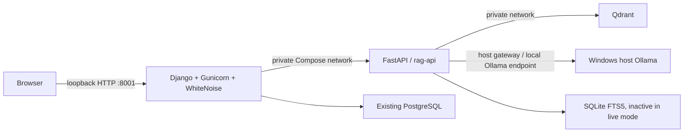

# Database and infrastructure

## Data responsibilities

| Component | Data | Persistence and role |
|---|---|---|
| PostgreSQL | Django users, conversations, messages, citation snapshots, generation metadata | Existing `rag_postgres_data`; Django owns app/user data. |
| Qdrant | Vector points and retrieval payloads in `rag_docs_v2` | Existing persistent store; current snapshot 58,856 points. |
| SQLite FTS5 | Sparse retrieval index | Local sparse index; hybrid path is inactive in current live strategy. |
| Filesystem | Raw corpus, processed runs, registries, manifest, logs, models/assets | Preserve provenance and operator records; never reset during routine app work. |

## Django schema

`Conversation` belongs to an authenticated user and has UUID identity, title and timestamps. `Message` belongs to a conversation and stores role/content/status. `CitationSnapshot` stores citation/source/document/chunk identifiers and sanitized source metadata. `GenerationMetadata` stores correlation and compact stage/model/index/verification metadata. Foreign-key cascades follow conversation/message ownership. See `django_app/conversations/models.py` and migrations. Raw evidence passages and internal prompts are not intended for conversation persistence.

## Integrity and concurrency review

`Message` has database check constraints for role/status; citation IDs are unique per message; generation metadata is unique per message; FK deletes cascade. `Conversation` has a `(user, -updated_at)` index; messages have `(conversation, created_at)`; citations have a document ID index; request IDs are indexed. No separate connection pool is configured beyond Django/database defaults.

`chat.views.message_create` uses one transaction to serialize first-message title creation and persist the user/pending assistant pair, then releases the transaction while the synchronous HTTP generation runs. A second transaction stores the completed response, citations and generation metadata. This avoids holding row locks during inference. A process crash between transactions can leave a `pending` assistant row. There is no idempotency key, so repeated browser submissions can create duplicate user messages and generations. This is a confirmed design limitation, not a measured data-corruption event. Conversation exports read the full message history to construct a response in memory and are not size-paginated; unusually large conversations could create memory/latency pressure. Conversation detail and list views are paginated/bounded.

The first-message title path uses `select_for_update()` to serialize concurrent first posts for one conversation. The synchronous RAG request itself has no durable job/outbox, cancellation or recovery mechanism. Tests exercise role/status constraints, ownership, persistence, citation and metadata behavior, but do not prove crash recovery or sustained concurrent submission semantics. No migration change was needed in the latest task.

## Infrastructure topology

Observed containers: `django_app-django-1`, `django_app-rag-api-1`, `rag-postgres`, `qdrant`, and a test-only `django_app-rag-api-synthetic-1`. Django is loopback-published at 127.0.0.1:8001; FastAPI is not host-published; PostgreSQL and Qdrant are loopback-published. Compose references existing external networks/data services. Do not run `down -v`.

## Runtime snapshot

Docker server 29.9.3; PostgreSQL 17.12; Qdrant 1.20.1; Ollama 0.40.16; host Windows 11, RTX 5050 Laptop 8,151 MiB GPU memory, i7-13645HX, 15.7 GiB RAM. These values can change. Current Qdrant API reports green and `rag_docs_v2` has 58,856 points, matching the manifest; it also reports `indexed_vectors_count=57,325`, eight segments, and an empty update queue. That separate index metric was not investigated further; it is not evidence that points are missing because the collection point count agrees with the manifest.

## Reliability and operations

PostgreSQL health and application persistence were tested. At Phase 6 final inspection on 2026-11-20, the app held 1 user, 3 conversations, 44 messages and 39 citation snapshots; the earlier 2026-11-19 count was 1/2/10/14 and is historical. Phase 6 candidate tests used isolated SQLite and did not write these application records. Backups and recovery instructions are in `docs/phase5/backup_recovery_guide.md`; actual backup freshness must be checked before each risky operation. No HA/failover, automated restore drill, replication, or point-in-time recovery proof is established here. Qdrant and Ollama dependency readiness is checked by FastAPI readiness. The Django app uses a synchronous worker and queues inference work.

## Safety rules

Reuse volumes and containers. Inspect service names and health first. Test migrations with `manage.py check` and `makemigrations --check --dry-run`; do not run destructive migration commands. Never publish Qdrant/Ollama/FastAPI on all interfaces for a local demo. A green health status means process health, not legal authorization or production readiness.
