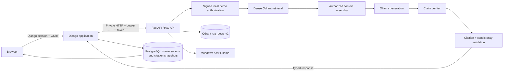

# Satell application architecture

## Responsibilities and boundaries

- The browser receives Django-rendered HTML and static assets. It never receives the FastAPI bearer token or any Qdrant/Ollama credentials.
- Django authenticates through its session framework, enforces conversation ownership in ORM queries, requires CSRF on state-changing forms, and persists messages, citation metadata, verification status, and bounded timings.
- The RAG client validates FastAPI schemas and citations and uses bounded HTTP timeouts. It does not silently fall back to mock mode in the running Compose configuration.
- FastAPI authenticates Django with a bearer token, derives tenant/principal scope server-side, validates the signed demo registries, and applies document authorization before retrieval/context assembly.
- Dense Qdrant retrieval is the configured runtime. Sparse BM25, RRF, and ONNX reranking are present but are not active in the current API service configuration.
- Ollama performs generation and claim verification. Citation validation and the narrow Python dictionary-version consistency detector can reject outputs. Retrieved passages are untrusted input; the model has no tool execution interface in this request flow.

## Network and persistence

Django binds only to `127.0.0.1:8001` on the Windows host and joins the existing `rag-app-network` and `satell-chat-rag`. FastAPI is private to `satell-chat-rag` and `satell-rag-service`. PostgreSQL is the existing `rag-postgres` service on `rag-app-network`; Qdrant is the existing `qdrant` service on `satell-rag-service`. Both persistent volumes are external and were preserved. FastAPI reaches host Ollama through `host.docker.internal:11434`; the Windows Ollama listener was observed on loopback.

## Request lifecycle

The authenticated user submits a bounded question with a CSRF-protected form. Django writes the user message and pending assistant row, calls FastAPI with a correlation ID, and then persists the final assistant message and citation snapshots in a transaction. On upstream failure it writes a generic failure message and classified metadata. The browser displays escaped Markdown rendered with DOM nodes, citation cards, and a safe verification label; private diagnostics and correlation IDs are not rendered.

For the exact API schema and failure behavior, see [API integration](api_integration.md). Production authorization remains blocked by pending human source/document review.
