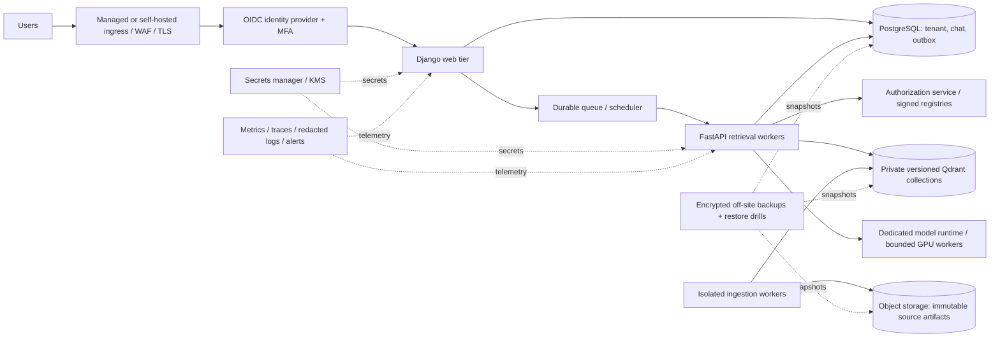

# Phase 6 architecture design

**Assessment date:** 2026-11-20. **Deployment target:** provider-neutral proposal; pending owner approval. No cloud resources were provisioned.

## Current baseline

The live local demo is Browser → Django/Gunicorn → bearer-authenticated FastAPI → local-demo authorization → dense Qdrant retrieval → bounded context assembly → Ollama generation and verification → citation validation → Django/PostgreSQL persistence. Evidence: `django_app/compose.yaml`, `django_app/compose.rag.yaml`, `src/rag_pipeline/api/app.py`, `src/rag_pipeline/service.py`, `django_app/chat/views.py`. Current inference is synchronous; there is no durable queue. Production manifest remains `operator_authorized_unreviewed` and legal reviews remain pending.

## Target proposal (not deployed)

Public ingress terminates TLS and applies request limits. Django owns human identity and tenant membership. A durable outbox/job layer separates web concurrency from inference concurrency. FastAPI receives a signed or mutually authenticated server-derived scope, never a browser-selected tenant. Retrieval applies Qdrant tenant and document filters, then context assembly rechecks each document. Ingestion runs separately and publishes immutable index versions only after validation. PostgreSQL, Qdrant, object storage and model services stay private. An external secret manager/KMS protects credentials and signing keys. Telemetry excludes prompts and document contents by default. Backup scope includes relational data, vector data, source artifacts, manifests, approvals, configuration and key-recovery material.

## Deployment alternatives

| Option | Privacy | Cost/capacity | Availability/scaling | Operational burden | Current decision |
|---|---|---|---|---|---|
| Self-hosted GPU | Strong local control; operator retains all data | Capital, power, GPU capacity; laptop is not validated for production | Can scale by adding managed GPU nodes; hardware failure is owner's responsibility | Highest hardware, patching, network, DR and on-call burden | Not selected; workstation remains demo only. |
| Cloud app + managed inference | App/database operations may be managed; prompts leave local machine to a provider | Usage and networking charges; capacity may be available on demand | Provider service levels and managed scaling are possible, subject to contract and region | Vendor, privacy, egress, IAM and model-service dependencies | Not selected; needs data/legal/vendor approval. |
| Hybrid private RAG + dedicated inference | RAG/index can remain private; inference placement is selectable | GPU pool or contracted inference cost; network latency between boundaries | Can scale application and inference independently | Complex identity, network, observability and incident boundaries | Preferred design candidate for evaluation, pending data classification and owner approval. |

No pricing, provider availability, or service-level claim has been researched or assumed. Before provider choice, compare privacy terms, GPU capacity and residency, availability, key control, backup/export, portability, and total operating cost with actual quotes and workload measurements.

## Trust boundaries

1. Browser is untrusted; it receives a session, never service credentials or tenant scope.
2. Ingress ↔ Django requires TLS, CSRF, authentication and session protections.
3. Django ↔ job service/FastAPI uses service identity, correlation and idempotency.
4. Retrieval workers ↔ authorization registries/Qdrant use least-privilege network and derived scopes.
5. Retrieved text and conversation history are untrusted inputs to generation.
6. Model output remains untrusted until claim, citation and consistency checks pass.
7. Ingestion workers have no query-serving identity and cannot publish without validated build approval.
8. Backups and diagnostic artifacts are sensitive stores with separate access/retention.

## Architecture decisions (provisional)

- Keep Django and the RAG service as separate trust/process boundaries. Current implementation supports this; remote transport must add TLS and service identity.
- Retain PostgreSQL for application transactions and Qdrant for vector search; do not combine stores to avoid a migration absent evidence.
- Keep dense retrieval as current fallback; do not enable BM25/RRF/reranker until reviewed evaluation demonstrates acceptable improvement.
- Do not use the laptop GPU as production capacity evidence.
- Use an outbox plus bounded worker pool as the design candidate; select broker only after target and operator capacity are approved.
- Use immutable/versioned index builds with a validation/activation boundary; preserve `rag_docs_v2` as academic reference.

## Decisions pending

Provider/deployment target, identity provider, data residency and classification, queue technology, inference hosting, SLO/RPO/RTO owners, monitoring stack, legal scope, and production corpus rights require human approval. This document is a proposal, not a deployment authorization.
